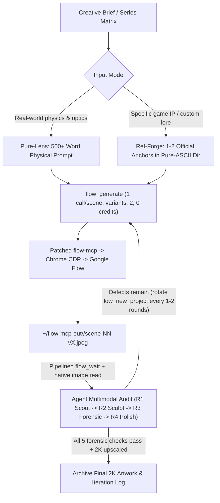

# Gemini Flow Visual Loop

An Agent Skill, four-stage multimodal critique workflow (`Visual-Loop`), and [`flow-mcp`](https://github.com/GTAI-1/flow-mcp) optimization guide for generating exhibition-grade still artwork on **Google Flow (Gemini Flow / Nano Banana)** at **0 credits per image** (including free 2K upscaled downloads).

Artwork series produced with this workflow (*Outer Wilds*, *Chants of Sennaar*, *GT3*, and *No Man's Sky*) are published at [Hazeyuh's Space · Relics](https://hazeyuh.me/relics.html).

## Why Single-Pass Flow Generation Breaks Down

Driving Google Flow for high-bar visual work hits two distinct bottlenecks—one in image models, and one in browser automation:

1. **The "Atmosphere Trap" in One-Shot Stills**: First-round generations often nail mood, palette, and texture while hiding severe geometric, optical, and setting defects—flat bull's-eye rings on water, light beams or bubble streams clipping across depth planes, unaligned mirror reflections, museum walls and spotlights around flat print/lacquer media, and real-world priors overriding fictional physics or anatomy.
2. **Browser Upload & Pacing Overhead in Default `flow-mcp`**: Out of the box, queuing multi-reference scenes through `flow-mcp` averages **~227 seconds per image**. Re-uploading local reference files consumes ~110–130 s per scene, paid-video pacing rules insert a 25–70 s random sleep after every 0-credit still, `asset:<name>` references accidentally trigger `CHARACTER LOCK` prompt suffixes on prior scene stills, and Flow's `Asset list` DOM truncates older items once a project grows past ~12–15 tiles.

This repository packages both halves of the fix: **three surgical `flow-mcp` patches + queue hygiene** that cut generation latency to **40–50 s/image (5.0×–5.7× faster)**, paired with a **four-round agentic vision audit** (`Scout` → `Sculpt` → `Forensic-Check` → `Polish` 2K) where a multimodal coding agent inspects every downloaded image on disk and rewrites targeted physical corrections until geometry, optics, and medium fidelity hold up at exhibition zoom.

## Workflow Architecture



## Measured Latency Benchmarks

Wall-clock timings recorded across multi-round 3-scene and 6-scene `Visual-Loop` batches on macOS (`GTAI-1/flow-mcp` + Chrome CDP):

| Pipeline Configuration | Batch Size | Wall-Clock Total | Per-Image Average | Speedup | Bottleneck Breakdown |
| --- | --- | --- | --- | --- | --- |
| Default `flow_generate` + 2–3 local disk reference uploads | 3 images | 683 s | **227.7 s/img** | `1.0×` | ~110–130 s local upload & thumbnail wait + ~55 s cloud render + 30–69 s queue pacing |
| `flow_agent_images` parallel Agent batch | 3 images | 343 s *(failed)* | **0 saved** | — | Stalls on `2 rendering` (~150 s), then times out (30 s) locating Flow's `Reuse prompt` button |
| Default `flow_generate` + in-project `asset:<title>` reuse | 3 images | 323 s | **107.7 s/img** | `2.1×` | Eliminates ~120 s local upload; still gated by ~55 s cloud render + 40–42 s default pacing |
| **Patched `flow-mcp` + `Pure-Lens` (`variants: 2`)** | 6 images (3×2) | 277 s | **46.2 s/img** | **`4.9×`** | 2–4 s image pacing + parallel variant rendering inside each scene |
| **Patched `flow-mcp` + `asset:` / clean project (`variants: 2`)** | 6 images (3×2) | 240–302 s | **40.0–50.3 s/img** | **`4.5×–5.7×`** | Cloud render dominates; local agent vision review + prompt rewrite adds `< 5 s` total |

## Two Input Modes & Orthogonal Series Design

Choose the input mode before drafting Round 1 prompts:

- **`Pure-Lens` (Text-First Mode)**: Best for architectural photography, motorsport (GT3), natural phenomena, and astrophysical or conceptual scenes where the base model already holds strong optical and physical priors. Use 0–1 mood references and drive the frame with a **500+ word** prompt specifying focal length, film stock or physical medium, Kelvin color temperature, directional light transport, foreground/midground/background planes, microscopic scale cues, and explicit exclusions.
- **`Ref-Forge` (Reference-Anchored Mode)**: Required for specific game worlds, fictional IPs, custom architectural motifs, or invented glyph systems (*Outer Wilds*, *Chants of Sennaar*, *No Man's Sky*).
  - **Collect primary visual sources**: Pull high-resolution 3D in-game screenshots and official concept sheets from the Steam Store API (`appdetails`), developer press kits, publisher galleries, or verified wiki glyph tables rather than fan art.
  - **Curate 1–2 anchor files per scene** (3–6 only when fusing distinct motifs) and symlink them into a **pure-ASCII directory** (such as `~/flow-mcp-out/project_refs/`) to avoid CJK/Unicode path encoding issues during browser upload.
  - **Assign explicit per-file roles & strip source HUDs in Round 1**: Name what each reference contributes (e.g., architectural silhouette vs. robe silhouette vs. glyph strokes) and explicitly remove source artifacts (in-game HUDs, cover typography, borders, or fossilized/dead props when depicting a living creature).
- **Orthogonal Series Matrix**: When producing a multi-image gallery (5–9 pieces), make every scene orthogonal across five dimensions—**core motif, aspect ratio (`16:9`, `3:4`, `9:16`, `1:1`, `4:3`), spatial vantage point, color palette, and physical medium** (e.g., black urushi lacquer with kintsugi gold, medieval astronomical tapestry with risograph grain, Gothic leaded stained glass, Edo woodblock print, Victorian cyanotype with gouache, 1970s hard-sci-fi matte painting, 65mm brutalist photography).

## The Four-Stage `Visual-Loop` Protocol

Every artwork runs through at least **4 rounds** with `variants: 2` per scene per round (0 credits on Flow stills):

1. **Round 1 — `Scout` (Composition, Scale & Palette)**:
   - Explore broad framing, scale hierarchy, and color palette across two variants per scene.
   - Inspect all downloaded candidates directly with the agent's multimodal file viewer and discard cramped framings or broken aspect compositions.
2. **Round 2 — `Sculpt` (Structural Reconstruction & Ghost Purging)**:
   - Feed the winning Round 1 image forward as a reference (`asset:<title>` inside an uncluttered project, or its local `~/flow-mcp-out/...` file path inside a fresh project).
   - Rebuild macro geometry: push megastructures asymmetrically beyond the frame edges, shrink oversized human or vehicle scale anchors, resolve 3D depth collisions, and **explicitly purge residual traces of deleted objects** (shadows, wakes, contrails, glow halos).
3. **Round 3 — `Forensic-Check` (Five-Point Geometric, Optical & Lore Audit)**:
   - Focus each revision on the **2–4 most visible defects** across five strict checks:
     1. **Horizon & Perspective**: Level unbroken horizons, straight architectural verticals, continuous ring/dome curvature without kinks or foreground/background pass-throughs.
     2. **3D Occlusion & Volumetric Terminations**: Clear depth layering; flashlight beams, sun shafts, fog ribbons, and sand columns must originate and terminate on physical surfaces (e.g., an upward underwater beam casting a matching illuminated patch onto an overhead stone ceiling).
     3. **Reflections & Surface Contact**: Mirror reflections aligned vertically below their source; boats, pillars, and travelers anchored by concentric waterline ripples, dark wet tide marks, snow footprints, or contact shadows.
     4. **Light Transport & Atmospheric Scattering**: Consistent light direction across all lit faces and cast shadows; realistic Rayleigh haze (a shadowed planetary night side behind daytime/twilight atmosphere cannot render blacker than the foreground sky).
     5. **Medium Purity & Lore Fidelity**: Edge-to-edge full-bleed rendering for traditional craft media; translucent water swells preserved without vertical waterfall streaks; world-specific rules enforced against generic priors (zero-G horizontal sand columns, nostril-free geometric masks, three-fingered alien hands, cold unlit thrusters on silent drift ships).
4. **Round 4 (or R4–R5) — `Polish` (Locked Geometry & Free 2K Export)**:
   - Lock the verified Round 3 composition (`strictly preserving its exact locked composition... Zero new objects, zero text, zero UI`).
   - Refine micro-surface textures (basalt pores, cotton rag fibers, cloisonné wire, photochemical 65mm grain, suspended Tyndall dust motes, wave-softened reflections) and request `download_quality: "upscaled"` for a free 2K final file.

## Field-Tested Model Pitfalls & Countermeasures

| Failure Mode | Typical Symptom in Flow | Proven Prompt & Workflow Fix |
| --- | --- | --- |
| **Atmosphere Trap** | Stunning colors hide clipped rings, floating boats, or warped horizons | Inspect every variant at full resolution against the 5-point `Forensic-Check` rubric before advancing |
| **Inpainting Ghosts** | Deleting a rock, person, or split contrail leaves orphaned whitewater, ghostly blue loops, or dark water blocks in R2 | Explicitly clear both the removed object **and** all secondary physical traces (reflection, wake, shadow, glow, contrail) |
| **Scale Collapse ("Toy UFO")** | Centered megastructure with visible top/side margins looks 40 meters wide | Crop asymmetrically past top and lateral frame edges, dissolve upper rooflines into mist, and shrink scale anchors to microscopic specks |
| **Ignored Bare Negations** | Writing `"no floating look"` or `"no neon"` leaves the defect intact | State the positive physical replacement (`"concentric waterline ripples around the hull"`, `"leaded turquoise stained-glass segments with dark solder cames"`) |
| **Gallery Installation Drift** | Prompting for a lacquer screen, tapestry, or porcelain plaque produces a 3D photo of a museum wall and wooden stand | Lock `full-bleed edge-to-edge flat artwork filling 100% of the frame, zero museum wall, zero frame, zero pedestal` from Round 1 |
| **Real-World Priors Overriding Lore** | Zero-G horizontal sand falls vertically like a waterfall; alien masks grow animal nostrils; 3-fingered hands become 5-fingered; stealth ships ignite thrusters | Re-anchor with official close-up references in R2/R3 and describe exact mechanical/anatomical geometry positively |
| **Stubborn Industrial Priors** | Brake discs glow as unbroken rings through wheel spokes; racing slicks retain faint grooves; wide GT3 splitters drift toward V-noses | Converge primary lighting/track geometry in R2–R3; treat sub-spoke occlusion and faint slick grooves as diminishing-returns priors |

Detailed before/after round progressions and reusable 500+ word prompt templates live in [`references/prompt-templates-and-cases.md`](references/prompt-templates-and-cases.md).

## Companion `flow-mcp` Setup, Patches & Operational Rules

### 1. Install `flow-mcp` Outside macOS Protected Folders

Clone [`GTAI-1/flow-mcp`](https://github.com/GTAI-1/flow-mcp) directly under your home directory (`~/flow-mcp`). Keep it out of `~/Documents`, `~/Desktop`, and `~/Downloads` on macOS so desktop agent apps do not hit TCC `EPERM: operation not permitted` errors when spawning the server:

```bash
git clone https://github.com/GTAI-1/flow-mcp.git ~/flow-mcp
cd ~/flow-mcp
npm install
```

### 2. Apply the `Visual-Loop` & `Flow Music (Lyria 3.5)` Patches

Apply [`patches/flow-mcp-visual-loop.patch`](patches/flow-mcp-visual-loop.patch) before building:

```bash
cd ~/flow-mcp
git apply /path/to/gemini-flow-visual-loop/patches/flow-mcp-visual-loop.patch
npm run build
```

What the patch changes:

1. **`src/queue.ts` — Separate Pacing for 0-Credit Images & Flow Music**: Introduces `FLOW_MCP_IMAGE_PAUSE_MIN_S` / `MAX_S` (default `2–4 s`) for `type === "image"` and `FLOW_MCP_MUSIC_PAUSE_MIN_S` / `MAX_S` (default `5–10 s`) for `type === "music"`, while keeping the `25–70 s` anti-bot pause on paid video generations.
2. **`src/core.ts` — Scoped `CHARACTER LOCK` Filter & `music_generate` Queue**: Excludes scene outputs matching `/(-scene-\d+|^fm-)/i` from triggering `CHARACTER LOCK` when referenced via `asset:<title>`, and adds `music_generate` (`tracks` batch of 1–20 songs) to `Core` / `LocalCore` / `RemoteCore`.
3. **`src/flow.ts` — Blank-Project `Agent` Toggle Guard**: Checks `await agent.isVisible()` before reading `aria-pressed` on Flow's `Agent` mode button, preventing 30-second timeouts right after `flow_new_project`.
4. **`src/chrome.ts`, `src/music.ts`, `src/index.ts`, `src/remote.ts` — Google Flow Music (`Lyria 3.5`) Extension (`flow_music_generate`)**: Adds a `flow_music_generate` MCP tool that silently reuses a background `https://www.flowmusic.app/session` tab (never calling `bringToFront()`), fills the Compose panel (`Sound description`, `Lyrics`, `Instrumental` / `Advanced` switches), waits for completion, and downloads `MP3` / `WAV` / `M4A` via Radix UI keyboard navigation + CDP `Browser.setDownloadBehavior` into `~/flow-mcp-out/<project>/track-NN.<ext>`. Combined with native multimodal audio reading (`read_file`), an agent can run multi-round **Audio-Loop** iterations (generate → listen silently on disk → critique genre drift, arrangement, and lyrical realism → rewrite & regenerate).

### 3. Sign In & Register MCP

```bash
cd ~/flow-mcp
npm run login
```

Sign into Google inside the dedicated Chrome window (`~/.flow-mcp/chrome-profile`, CDP port `9333`), open or create a Flow project, and keep the window open and display awake (`caffeinate -dimsu` on macOS during long runs).

Register the server with an absolute `node` path (`which node`, e.g. `/opt/homebrew/bin/node`):

```json
{
  "mcpServers": {
    "flow": {
      "command": "/opt/homebrew/bin/node",
      "args": ["/Users/<you>/flow-mcp/dist/index.js"]
    }
  }
}
```

- **Antigravity**: `~/.gemini/config/mcp_config.json` (or `~/.gemini/antigravity/mcp_config.json`)
- **Codex CLI / App**: `~/.codex/config.toml` (`[mcp_servers.flow]`)
- **Claude Code**: `claude mcp add --scope user flow -- /opt/homebrew/bin/node ~/flow-mcp/dist/index.js`

### 4. High-Reliability Queue & Recovery Rules

- **Use `flow_generate` (1 scene per call), skip `flow_agent_images` for iterative loops**: Queue multi-reference scenes with separate parallel `flow_generate` calls and pure-ASCII reference paths. Avoid `flow_agent_images` (prone to `Reuse prompt` 30 s timeouts that drop the entire batch) and avoid passing local paths to `first_frame` on still images (use `reference_images`).
- **Rotate projects every 1–2 rounds (`flow_new_project`)**: Flow's web `Asset list` drawer only exposes the newest ~12–15 items in the DOM (causing 10 s `asset:<title>` lookup timeouts on older items), and any tile stuck at `99%` slows subsequent uploads. Open a fresh project with `flow_new_project` every 1–2 rounds and pass the winning local file path (`~/flow-mcp-out/<prev-project>/scene-NN-vX.jpeg`) across project boundaries.
- **Instant recovery from `fetch failed` (`RemoteCore` dangling state)**: When an earlier primary `flow-mcp` process exits while a secondary MCP client remains in `RemoteCore` mode, `flow_status` reports `fetch failed` even though Chrome CDP (`9333`) is still live. Start `/opt/homebrew/bin/node ~/flow-mcp/dist/studio.js` in the background to re-bind `127.0.0.1:8787` immediately without restarting your agent or logging in again.
- **Pipelined inspection & credit safety**: Poll `flow_wait` and inspect newly finished scenes immediately while remaining jobs finish. Stills and 2K upscales cost **0 credits**; before any paid video call (`type: "video"`, `flow_edit`, `flow_continue`), check `flow_status`, confirm estimated cost with the user, and set `max_credits`.

Full troubleshooting tables and tool-by-tool notes live in [`references/flow-mcp-runbook.md`](references/flow-mcp-runbook.md).

## Installation as an Agent Skill

Clone directly into your agent's skill discovery directory:

```bash
# Antigravity / Gemini global skills
git clone https://github.com/Hazeyuh/gemini-flow-visual-loop ~/.gemini/config/skills/gemini-flow-visual-loop

# Or shared multi-agent skills directory (Codex / Claude Code / Antigravity)
git clone https://github.com/Hazeyuh/gemini-flow-visual-loop ~/.agents/skills/gemini-flow-visual-loop
```

## Repository Contents

| Path | Purpose |
| --- | --- |
| [`README.md`](README.md) | Human-facing overview, latency benchmarks, 4-stage `Visual-Loop` methodology, pitfalls, and setup |
| [`SKILL.md`](SKILL.md) | Progressive-disclosure Agent Skill instructions for Antigravity, Codex, and Claude Code |
| [`patches/flow-mcp-visual-loop.patch`](patches/flow-mcp-visual-loop.patch) | Unified diff against `GTAI-1/flow-mcp` (`src/chrome.ts`, `src/core.ts`, `src/flow.ts`, `src/index.ts`, `src/music.ts`, `src/queue.ts`, `src/remote.ts`) |
| [`references/prompt-templates-and-cases.md`](references/prompt-templates-and-cases.md) | 500+ word `Pure-Lens`, `Ref-Forge`, `Sculpt`/`Forensic`, and 2K `Polish` prompt templates + R1–R4 case studies |
| [`references/flow-mcp-runbook.md`](references/flow-mcp-runbook.md) | Tool selection matrix, `RemoteCore` recovery, project rotation rules, and credit guardrails |
| [`agents/openai.yaml`](agents/openai.yaml) | Implicit skill invocation policy metadata |
